<div align="center">

# NetSpeedTray

    [](#install) [](https://apps.microsoft.com/detail/XP9MHWQZJPLQM8) 

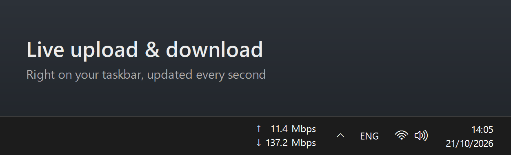

**Live network speeds, CPU/GPU stats, temperatures, and power draw - right on your Windows taskbar.**
Free and open source, signed, no ads, no telemetry. The feature Windows forgot.

[**Install**](#install) · [**Quick Start**](#quick-start) · [**Features**](#what-you-get) · [**The Monitor**](#the-monitor) · [**Hardware & temperatures**](#hardware-monitoring---do-i-need-librehardwaremonitor) · [**FAQ**](#faq) · [**Discussions**](https://github.com/erez-c137/NetSpeedTray/discussions) · [**Support 💛**](#-support-netspeedtray)

</div>

> 🎉 **New in 2.2.1:** an optional 0.5 s update rate, every GPU listed when you hover the widget, a hybrid
> laptop's NVIDIA GPU left to sleep, the Wi-Fi name without Location access, and a quiet notice by the widget
> when an update is out. [Read the release notes →](https://github.com/erez-c137/NetSpeedTray/releases/latest)

---

## Install

```powershell
winget install --id erez-c137.NetSpeedTray
```

Or grab the latest [**Setup.exe** or **Portable.zip**](https://github.com/erez-c137/NetSpeedTray/releases/latest) directly. Both are signed by the SignPath Foundation, so Windows shows a verified publisher instead of an "unknown publisher" warning.

Also on the [**Microsoft Store**](https://apps.microsoft.com/detail/XP9MHWQZJPLQM8) - the same signed installer and the same free, open-source app, one click from the Store. It's the *only* NetSpeedTray on the Store; anything with a similar name isn't this project.

**Which one?** **Setup.exe** installs NetSpeedTray for you; **Portable.zip** runs from any folder and updates itself in place. WinGet and the Store install the same signed Setup.

**Requirements:** Windows 11 or 10 (64-bit) - Windows 11 is the main target, Windows 10 is best-effort, and Windows 7 and 8 aren't supported. The widget needs no admin rights. CPU/GPU **temperatures** on some hardware need an optional helper - [see below](#hardware-monitoring---do-i-need-librehardwaremonitor).

**Deploying to several PCs?** Silent install, per-machine and per-user details, the update policy and every network connection the app makes are in [DEPLOYING.md](DEPLOYING.md).

---

## Quick Start

1. **Right-click the widget** for **Settings**, the **Monitor**, **Check for Updates**, or **Exit**. Add **Pause / Resume**, or hide items you don't use, under **Settings → General → Right-click menu items**.
2. **Double-click the widget** to open the **Monitor** (history, per-app activity, hardware, statistics).
3. **Hover over it** for the hover card - the data you've used today and this month (and your cap, if you set one), plus CPU, GPU, memory and, on a laptop, battery if you turn them on. Click to pin it open.
4. **Drag it to reposition** - grab the widget and drag it along the taskbar to wherever you like; it remembers the spot. Turn on **Free move (no snapping)** in **Settings → Widget** to place it anywhere, including off the taskbar.
5. **Want temperatures?** Many NVIDIA and Intel PCs show some out of the box; for the rest, see [Do I need LibreHardwareMonitor?](#hardware-monitoring---do-i-need-librehardwaremonitor)

---

## Why NetSpeedTray?

Windows has shown network usage in Task Manager since forever - but you have to *open Task Manager to see it*, and it's gone the moment you click away. That's the gap I wanted to fill on my own machine, and I couldn't find a widget I trusted to do it cleanly.

So I built NetSpeedTray: live up/down speeds, CPU and GPU utilization, temperatures, and power draw - all sitting in your taskbar where you can glance at them without breaking your flow. No browser tab open, no telemetry, no ads, no tracking. Built with Python and PyQt6, and signed by the [SignPath Foundation](https://signpath.org/) so it installs cleanly.

---

## What You Get

🌐 **Network on your taskbar.** Live upload and download speeds, updated every second by default - or twice a second if you want it. Auto-detects your primary internet connection or lets you pick specific adapters. Color-code Low / Medium / High speeds so heavy traffic stands out at a glance. The readout sits *inside* the taskbar's layer - it stays put through the Start menu, Quick Settings, and the tray overflow instead of disappearing.

📍 **Every taskbar, every position.** Bottom, top, left or right, and Windows 11's Small taskbar - move or resize the taskbar and the widget follows, no restart. When your app buttons reach the widget it steps aside and comes back when there's room. With "Show my taskbar on all displays" on, it can put a copy on every taskbar.

🖥️ **Hardware stats too.** CPU and GPU utilization beside your network speeds, with optional temperature (°C or °F), power (Watts), RAM, and VRAM. Vendor-agnostic GPU support - NVIDIA, AMD, and Intel. On a PC with two or more GPUs you pick the one the taskbar shows, and the hover card lists them all. RAM and VRAM can show without CPU or GPU, too. ([When do temps need a helper? →](#hardware-monitoring---do-i-need-librehardwaremonitor))

🪟 **A hover card.** Point at the widget for today's and this month's data usage - and, if you like, CPU, GPU, memory and, on a laptop, battery, so the taskbar itself can stay just your network speed. Click to pin it open.

📊 **The Monitor.** One window, three tabs - **Overview, Network, Hardware** - with history charts, per-app connections, per-process resource use, and statistics you can export to CSV/JSON. Double-click the widget to open it.

📈 **Usage & data caps.** Usage by day, month and year, a settable monthly cap with a billing reset day, and 80% / 100% alerts - shown as a quiet flyout above the widget, no extra tray icon. Your history is exact bytes in a local SQLite file you can back up, query or wipe from Settings.

🩺 **Network latency & packet loss.** A light probe of your own router shows a plain-word verdict - **Router: Good / OK / Slow** - with the milliseconds as quiet subtext, and it stays on your LAN - your real router, even with a VPN up. One click (**Also check your internet**) adds a public host, and the verdict reads **Internet: ...** then. **Check connection** tells you whether packet loss starts on your Wi-Fi or beyond it.

🎨 **Make it yours.** Layout modes, fonts, decimals, arrow styles, color thresholds, a mini graph (Trend or Detailed, your colors, or split upload/download), one color scheme that switches with Windows' light/dark mode, and a live preview in Settings that shows the exact effect before you commit.

🔒 **Trustworthy by design.** Open source under GPLv3. Signed installer, zero ads/tracking/telemetry, logs auto-redacted of paths/IPs/MACs/hostnames/adapter names, and an in-app updater that *verifies the signature* and the release's checksums before running anything - and, for the portable build, every file it installs. And it stays free: GPLv3 means that even if I lose interest or get hit by a bus, the code can't be bought, closed, or paywalled out from under you - anyone can fork it.

<details>
  <summary>&nbsp;&nbsp;<b>➕ Choose what it shows</b> - just speeds, a mini-graph, CPU/GPU/RAM, temps &amp; power</summary>
  <br/>
  <div align="center">
  <table>
    <tr>
      <td align="right">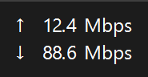</td>
      <td align="left">&nbsp;&nbsp;at its simplest, just your up &amp; down speeds</td>
    </tr>
    <tr>
      <td align="right">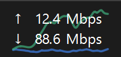&nbsp;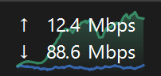</td>
      <td align="left">&nbsp;&nbsp;+ a live mini-graph - Trend (default) or Detailed</td>
    </tr>
    <tr>
      <td align="right">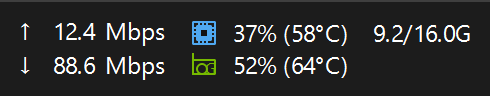</td>
      <td align="left">&nbsp;&nbsp;+ CPU &amp; GPU, in brand colors</td>
    </tr>
    <tr>
      <td align="right">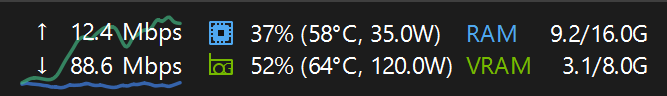</td>
      <td align="left">&nbsp;&nbsp;everything at once - temps &amp; power too</td>
    </tr>
    <tr>
      <td align="right">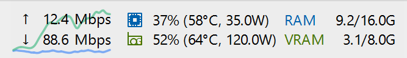</td>
      <td align="left">&nbsp;&nbsp;on a light taskbar</td>
    </tr>
    <tr>
      <td align="right">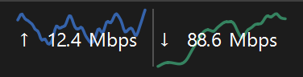</td>
      <td align="left">&nbsp;&nbsp;split graphs - upload and download, each on its own scale</td>
    </tr>
    <tr>
      <td align="right">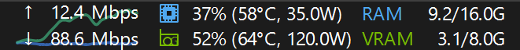</td>
      <td align="left">&nbsp;&nbsp;on a Small (32 px) taskbar</td>
    </tr>
    <tr>
      <td align="right">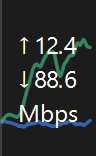</td>
      <td align="left">&nbsp;&nbsp;on a side taskbar - compact, details on hover</td>
    </tr>
  </table>
  </div>
</details>

<details>
  <summary>&nbsp;&nbsp;<b>⚙️ Settings</b> - six pages, a live preview, and a Windows 11 feel</summary>
  <br/>
  <div align="center">
    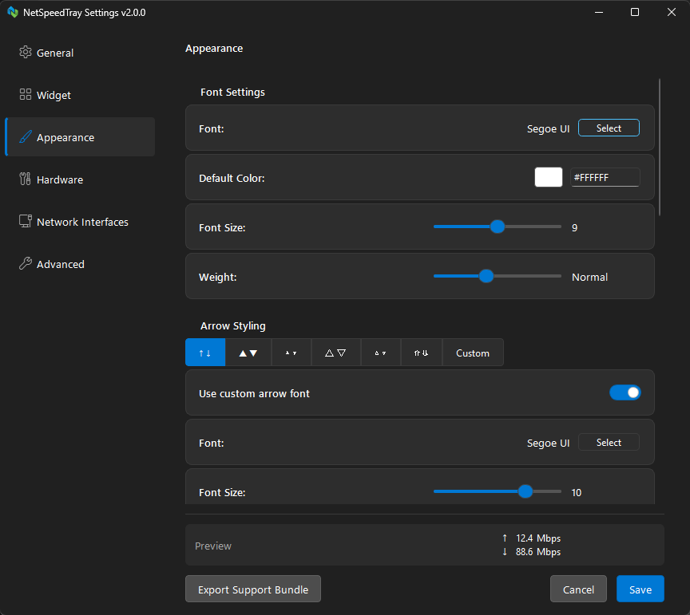
    <p><sub><b>Appearance</b> - fonts, colors, and arrow-style presets, with a live widget preview at the bottom that updates as you change things.</sub></p>
    <br/>
    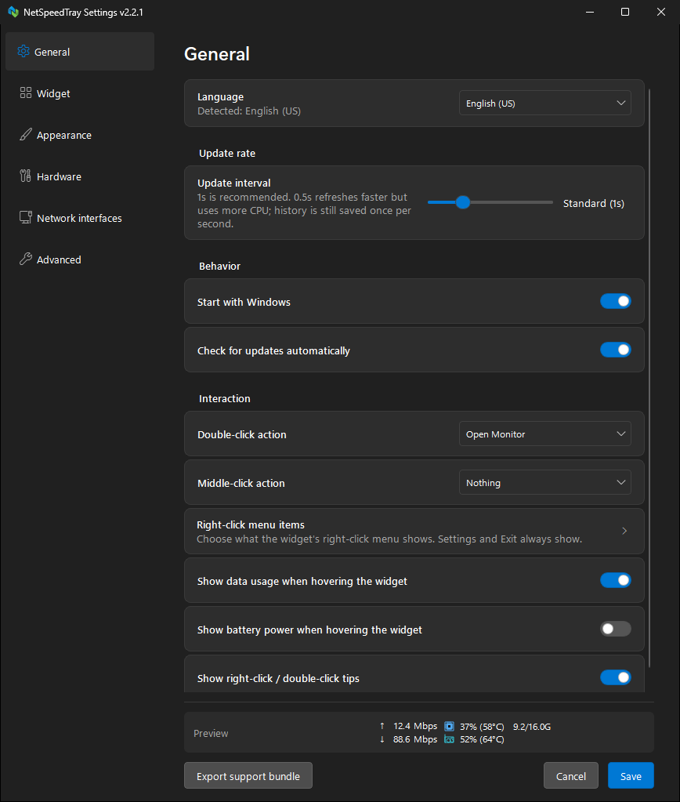
    <p><sub><b>General</b> - language, update rate, startup, automatic update checks, double-/middle-click actions and what the right-click menu shows. Six pages in all: General · Widget · Appearance · Hardware · Network interfaces · Advanced.</sub></p>
  </div>
</details>

---

## The Monitor

Double-click the widget (or pick **Show Monitor** from the right-click menu) for the whole story behind the numbers: one window, three tabs - **Overview, Network, Hardware** - on one shared timeline.

<div align="center">
  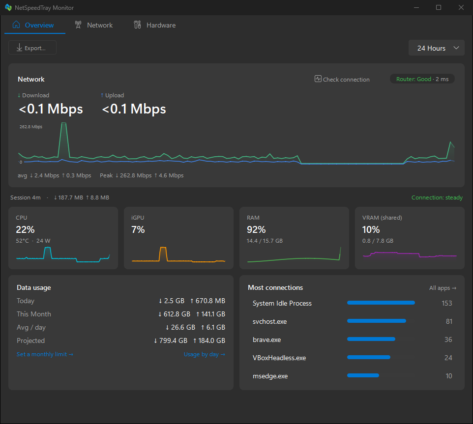
  <p><sub><b>Overview.</b> Live tiles for network, CPU, GPU, RAM and VRAM with sparklines that span the whole time range and adapt their scale, a network hero with inline latency, a strip with session uptime, period totals and CPU + GPU power, a data-usage card, and the apps with the most connections - every card drills into detail. Its sparklines are drawn natively, so a quick glance never loads the plotting library.</sub></p>
</div>

<p align="center"><i>↓ Click to explore the rest ↓</i></p>

<details>
  <summary>&nbsp;&nbsp;<b>🌐 Network</b> - history graph + honest per-app connections</summary>
  <br/>
  <div align="center">
    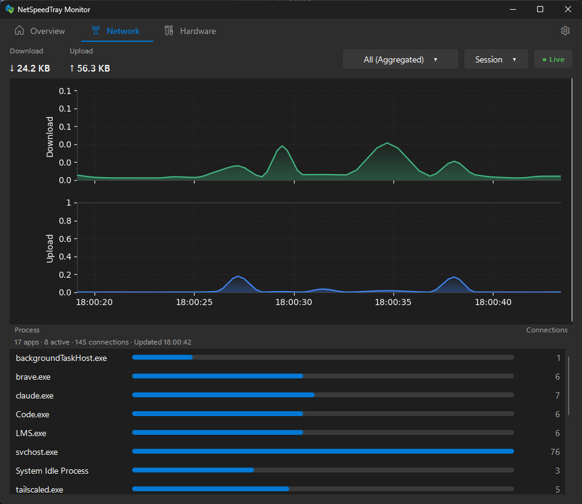
    <p><sub>Up/down history over a live per-app <b>connection</b> list - how many each program holds, how many are active, and the distinct hosts it reaches - with a per-NIC filter that scopes the graph and the totals. No fake per-app "speeds": Windows can't attribute network bytes per app without a kernel driver, so nothing is dressed up.</sub></p>
  </div>
</details>

<details>
  <summary>&nbsp;&nbsp;<b>🖥️ Hardware</b> - combined CPU/GPU graph + per-process usage</summary>
  <br/>
  <div align="center">
    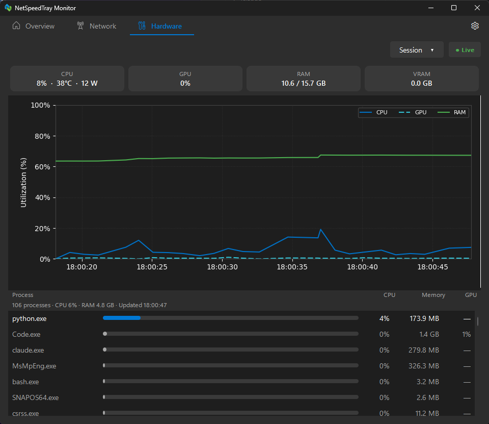
    <p><sub>A combined CPU + GPU + RAM history graph (separate axes or one at a time, optional smoothing, fixed or auto scale) over a live per-process <b>CPU / RAM / GPU%</b> list, plus a telemetry band of temperatures, power, and memory.</sub></p>
  </div>
</details>

- **📐 Honest statistics & export.** Click any card for a **Statistics** sheet: the real distribution (min / avg / peak, with percentiles shown only where they're exact), peak vs off-peak, throttle time, and connection drops - at least two failed checks in a row (about 6 seconds), so a single blip isn't counted as an outage. **Copy** or **Export** the window to a CSV + JSON bundle - and there's a headless `NetSpeedTray.exe --export-csv` for scripted/automation use.

- **⏯️ Live / Pause & a Windows 11 feel.** Freeze a chart to read a moment, then resume. Native dark title bar and rounded corners, a Fluent tab strip, remembered size/position/last-tab, a default size that fits the whole Overview without scrolling, and full keyboard navigation (Tab to the cards and tabs, Enter/Space to drill in).

---

## Hardware Monitoring - do I need LibreHardwareMonitor?

**Utilization is always free.** CPU, GPU, RAM, and VRAM **usage** read natively through Windows performance counters and psutil - no admin, no helper, all vendors. That part just works.

**Temperatures and power are the nuanced bit.** NetSpeedTray reads what Windows and your drivers expose on their own, and when [LibreHardwareMonitor](https://github.com/LibreHardwareMonitor/LibreHardwareMonitor) (LHM) is running it prefers LHM's sensors, which are the accurate ones for CPU temperature. Whether you need LHM depends on your hardware:

| Reading | Works natively (no helper, no admin) | Needs LHM (run as admin) for full coverage |
|---|---|---|
| CPU / GPU / RAM / VRAM **usage %** | ✅ always | - |
| **GPU temperature** | ✅ NVIDIA (via `nvidia-smi`) | AMD & Intel discrete GPUs |
| **GPU power** | ✅ NVIDIA + Intel iGPU | AMD GPUs |
| **CPU temperature** | ⚠️ only if your board exposes ACPI thermal zones | AMD Ryzen, and boards without usable zones |
| **CPU power** | ✅ Intel (RAPL) | AMD CPUs |

**In plain terms:** on a typical **NVIDIA + Intel** PC you'll see most temps and power without installing anything. If you have an **AMD CPU**, accurate CPU temperature and power realistically need LHM. To enable it, install **[LibreHardwareMonitor](https://github.com/LibreHardwareMonitor/LibreHardwareMonitor/releases/latest)**, run it **as Administrator**, and turn on **Options → Remote Web Server** (v0.9.5 and newer; port 8085) - NetSpeedTray detects it automatically and temps and power across all vendors light up. NetSpeedTray only ever asks `127.0.0.1`, but LHM up to v0.9.6 listens on every interface, so **don't open its port in your firewall**, and pick 127.0.0.1 once a newer LHM offers it. If you turn on its authentication, enter the same user name and password in **Settings → Hardware**. On a PC with two or more GPUs, pick the one to show in **Settings → Hardware** (Automatic follows the busiest); its temperature and power then come only from a sensor of that GPU's maker, and the hover card lists every GPU from its own sensors ([#236](https://github.com/erez-c137/NetSpeedTray/issues/236)).

On a hybrid (Optimus) laptop, the NVIDIA GPU's temperature and power show while it's awake - NetSpeedTray lets it sleep rather than wake it to read them.

> NetSpeedTray itself **never runs as admin and never ships a kernel driver.** Reading CPU/GPU die
> temperatures requires a driver that Windows doesn't expose to normal apps; LHM provides that driver and
> publishes the values, which NetSpeedTray simply reads - from LHM's local web server on v0.9.5 and newer
> (`127.0.0.1` only, never through a proxy), or over WMI on v0.9.4 and older. Your choice, fully optional.

---

## FAQ

<details>
<summary><b>Will it slow down my PC?</b></summary>

Idle RAM is about **40-50 MB** - that's the number Windows Task Manager shows you (its *full* working set, which counts the shared Windows/Qt DLLs it maps, is ~100 MB), and CPU sits near zero between updates (~0.1-0.2% at the default 1 s; a bit more at 0.5 s). It wakes only to take its readings, so it's easy on a laptop battery. The Monitor's Overview tab is deliberately chart-free and re-reads long time ranges only every so often, so glancing at it - or leaving it open - stays light; opening the Network or Hardware **charts** loads the plotting library for the session, which adds roughly **50-60 MB** while the Monitor is open - close the Monitor and it eases back down. The widget polls every ~1 second (0.5 s if you choose it) using the same Windows APIs Task Manager uses.

</details>

<details>
<summary><b>Does it work with a top, side or Small taskbar?</b></summary>

Yes. The widget docks to Windows 11's taskbar at the bottom, top, left or right, and on the Small (32 px) taskbar; move or resize the taskbar and it follows without a restart. On a side taskbar it switches to a compact layout and shows the details on hover. When your app buttons reach the widget it steps aside, and comes back when there's room. On Windows 10 and ExplorerPatcher taskbars it docks the way it always did, without the step-aside.

</details>

<details>
<summary><b>The widget disappeared, or it's in the wrong spot - what now?</b></summary>

If you dragged it somewhere odd, right-click it and pick **Reset Position** (it shows in the menu once you've moved the widget). If it vanished while your taskbar filled up with app buttons, it stepped aside so it wouldn't cover them - it comes back when there's room, or turn off **Hide while app buttons cover the widget** in **Settings → Widget** to keep it visible. If it isn't running at all, start NetSpeedTray from the Start menu; **Start with Windows** in **Settings → General** brings it back after every restart.

</details>

<details>
<summary><b>How do I update?</b></summary>

The app checks for a new release about once a day - at startup, while it runs, and after your PC wakes - and shows a small notice by the widget when there is one; **Check for Updates** in the right-click menu checks right away (if you've hidden it, turn it back on in **Settings → General**). Every download is verified before anything runs, and the portable build updates itself in place. With WinGet you can also run `winget upgrade erez-c137.NetSpeedTray`. Betas are never offered - trying one is always a manual download. To turn update checks off across many PCs, see [DEPLOYING.md](DEPLOYING.md).

</details>

<details>
<summary><b>How do I uninstall it?</b></summary>

Installed with Setup, WinGet or the Store: **Settings → Apps → Installed apps → NetSpeedTray → Uninstall**, and the uninstaller asks whether to delete your settings and history too. Portable: turn off **Start with Windows** in Settings, exit, and delete the folder. Settings and history live in `%APPDATA%\NetSpeedTray\` - delete that folder to remove them.

</details>

<details>
<summary><b>Do I need LibreHardwareMonitor?</b></summary>

Often no - see the [hardware table above](#hardware-monitoring---do-i-need-librehardwaremonitor). Usage stats, NVIDIA GPU temperature and NVIDIA/Intel power work natively; LHM (run as admin, with its Remote Web Server on) is the universal fallback and the realistic way to get **AMD CPU** temperature and power. The widget never asks for admin itself.

</details>

<details>
<summary><b>Can I set a data limit and get warned?</b></summary>

Yes - **Settings → Network interfaces → Data usage**. Set a monthly cap and a billing reset day, and you get 80% / 100% alerts (you can turn them off). The alert is a quiet flyout above the widget, and the hover card and the Monitor show how much of the cap you've used. The cap counts what the **Monitoring mode** counts, on this PC only: **Auto** meters just the adapter your traffic is routed through (with a VPN connected that is usually the VPN's, so its overhead and any traffic that bypasses it are left out), while **Physical adapters only** adds up every real adapter and leaves VPN, tunnel and virtual adapters out so nothing is counted twice - the closer match to your provider's bill.

</details>

<details>
<summary><b>Does the latency check phone home?</b></summary>

Only if you ask it to. The default target is your own **gateway**, which never leaves your LAN - a burst of four small pings every 3 seconds, about 1.3 packets a second. Pinging a public host is a separate, explicit opt-in where *you* choose the host. The Monitor's **Check connection** button sends 20 pings to your router, and to the public host only if that opt-in is on or you tick the box that names it, just for that check. Nothing else about your network is sent anywhere - there's no telemetry of any kind.

</details>

<a id="why-does-the-network-name-need-location-access"></a>
<details>
<summary><b>Does the network name need "Location" access?</b></summary>

No. The Wi-Fi **band** (2.4G / 5G) never needed a permission, and the **network name (SSID)** comes from a Windows API that doesn't need **Location** either - it doesn't scan nearby networks, and nothing shows up under Location's recent activity. It's read **locally**, only to show it on the widget, and never stored or sent ([Privacy Policy](privacy.md)). 2.2.0 and older did need Location for the name.

</details>

<details>
<summary><b>Where does it store data and settings?</b></summary>

`%APPDATA%\NetSpeedTray\` - `NetSpeedTray_Config.json` for settings, `speed_history.db` (SQLite) for network/hardware history, and rotated logs. Everything stays local. Settings has an **Export support bundle** button that auto-redacts paths, IPs, hostnames, MACs, and adapter names for clean bug reports. The database's schema, example queries, and how to restore a backup are all documented in [DATABASE.md](DATABASE.md).

</details>

<details>
<summary><b>My history totals dropped after updating to 2.2 - did I lose data?</b></summary>

No. 2.1.x over-counted quiet minutes; 2.2 stores the exact bytes measured, and estimates the days before the upgrade honestly. Nothing was deleted, your data-cap figure doesn't change, and the first 2.2 launch keeps your old history file as a backup ([DATABASE.md](DATABASE.md) has the details).

</details>

<details>
<summary><b>SmartScreen or Smart App Control blocks it - is that a problem?</b></summary>

You probably grabbed an unsigned dev build. The official releases ([Setup.exe / Portable.zip](https://github.com/erez-c137/NetSpeedTray/releases/latest)) are signed by the SignPath Foundation and shouldn't trip SmartScreen, and the installed app itself is signed too, so a clean install runs with Smart App Control on.

</details>

---

<details>
<summary><b>📋 Full Feature List</b> (click to expand)</summary>

### Network Monitoring
- **Live upload/download** on the taskbar, every second - or every 0.5 s with **Real-time (0.5s)**
- **Auto-primary mode** - follows the adapter your internet traffic is routed through right now (with a full-tunnel VPN connected, that is the VPN's)
- **Interface filtering** - all hardware, specific adapters, or include virtual interfaces
- **Color coding** - Low / Medium / High speed levels with your own thresholds and colors; the default colors stay apart with red-green color blindness
- **Network identity** - show the Wi-Fi **band** (2.4G / 5G) and, optionally, the **network name (SSID)** on the widget as a small pill; color-code it, or use **alert-only** mode to flash a red `2.4G` *only* when your PC has silently dropped to the slow band. Neither needs Location access; both are read locally and never sent ([more](#why-does-the-network-name-need-location-access))
- **Per-app connections** (in the Monitor) - live connection counts and remote hosts per program, no admin needed

### Hardware Monitoring
- **CPU & GPU utilization** on the taskbar - always native (psutil + Windows PDH), all vendors, no admin
- **RAM & VRAM** usage, on their own or beside CPU/GPU (an integrated GPU's shared memory shows as VRAM; "N/A" instead of a fake 0 when there is no counter)
- **GPU picker** - on a PC with two or more GPUs, choose which one the widget shows (Automatic follows the busiest); the hover card lists **every GPU** with its own usage and memory, plus temperature and power where you've turned them on
- **Hybrid (Optimus) laptops** - the NVIDIA GPU is left to sleep: NetSpeedTray reads its temperature and power only while it's already awake, and the hover card marks it **Idle** meanwhile
- **°C or °F**, and **Brand / Match text / Custom** colors for the CPU and GPU labels
- **Hover card** - today's and this month's data usage on hover, plus CPU, GPU, memory and battery if you like; click to pin; optionally show hardware *only* there
- **Temperatures** - CPU: LibreHardwareMonitor web server, then LHM v0.9.4/OpenHardwareMonitor (WMI), then ACPI thermal zones; GPU: LibreHardwareMonitor, then NVIDIA `nvidia-smi`
- **Power (Watts)** - CPU (LHM, else Intel RAPL) and GPU (LHM, else NVIDIA, else Intel iGPU RAPL); an opportunistic whole-system figure on laptops running on battery. Desktops can't read true wall power in software, so the Monitor honestly shows the CPU + GPU breakdown
- **LibreHardwareMonitor auto-detection** - if LHM (web server on, v0.9.5+) or LHM v0.9.4/OHM is running as admin, it's picked up automatically for temps/power across all vendors

### The Monitor
- **Overview** - at-a-glance tiles + adaptive sparklines, a network hero card, a context strip, a Data-usage card, and Most connections
- **Network** - history graph + per-app connection list + per-NIC filter + detail panel
- **Hardware** - combined CPU+GPU graph (modes/smoothing/axis) + per-process CPU/RAM/GPU% + telemetry band
- **Statistics & export** - honest distributions (exact percentiles only where the data supports them), Copy/Export to CSV + JSON, and a headless `--export-csv` CLI
- **Live / Pause**, remembered window state, native Win11 chrome, full keyboard navigation
- **Usage by day, month and year**, and **Check connection** - where packet loss starts, your Wi-Fi or beyond
- **Exact history** - bytes as measured, raw (24h) → minute (30d) → hourly (up to "Keep everything"), for network *and* hardware; **Back up** or **Delete** history from Settings

### Widget Layout & Customization
- **Layout modes** - Side-by-Side, Stacked, or Auto-Cycle (rotates Network / CPU / GPU); per-segment ordering
- **Mini graph** - Trend (smoothed) or Detailed, your own upload/download colors, optionally split into two graphs on their own scales; adjustable opacity, auto-scaled or **fixed to your plan speed** (+0/10/20/30% headroom, optional dotted plan-speed line)
- **Arrow styles** - Classic ↑↓, Solid ▲▼, Compact ▴▾, Outline △▽, Outline Compact ▵▿, Double ⇑⇓, or Custom
- **Live settings preview** - see the exact widget effect (font/color/arrows/layout/mode) before you commit
- **Configurable click actions** - reassign double-click / middle-click on the widget (Open Monitor, Settings, Pause/Resume, or nothing)
- **Choose the right-click menu** - show or hide Show Monitor, Pause / Resume, Reset Position, Check for Updates and Support this Project; Settings and Exit always stay
- **One color scheme for light and dark** - switches with Windows' mode, accent-colored taskbars kept readable, **font & precision** control, **fixed-width** values to prevent jitter
- **Units** - bits or bytes, decimal (Mbps, MB/s) or binary (Mibps, MiB/s), with toggleable suffixes
- **Line spacing** between the upload and download rows, up to 4 px tighter or looser than the default

### Positioning & Integration
- **Taskbar-docked** - stays above the taskbar through the Start menu, flyouts, and the tray overflow
- **Drag to reposition** - drag the widget to move it along the taskbar; your spot is remembered. **Free move (no snapping)** lets you place it anywhere, including off the taskbar
- **Preferred monitor** - pin to a specific display (auto free-floats on a taskbar-less screen)
- **Survives** sleep/resume, monitor add/remove/primary-swap, Explorer restarts, and Remote Desktop sessions
- **Every Windows 11 taskbar position** - bottom, top, left, right and Small (32 px); follows moves and resizes without a restart, with a compact layout on side taskbars
- **Steps aside for your app buttons** when they reach the widget, and comes back when there's room - and stays off Windows 10-style taskbar toolbars (Desktop, Links)
- **Show on all taskbars** - a copy of the widget on every display's taskbar (opt-in)
- **Reset Position** in the right-click menu, and **high-DPI** aware, including scale changes while it runs

### Accessibility
- **Keyboard-navigable Monitor** - Tab to cards and tabs (accent focus ring), Enter/Space to activate, accessible names for screen readers
- **High Contrast themes** - the widget paints in the theme's text color
- **Reduce motion** - app-wide flag, and automatic respect for the Windows "Animation effects" setting

### Security & Privacy
- **Digitally signed** by the [SignPath Foundation](https://signpath.org/) - a verified publisher, not an "unknown publisher" warning
- **100% open source** (GPLv3) - no ads, no tracking, no telemetry · [Privacy Policy](privacy.md)
- **Your history is a plain SQLite file you can query yourself** - schema, units and example queries in [DATABASE.md](DATABASE.md)
- **PII obfuscation** - logs auto-redact paths, IPs (incl. IPv6), MACs, hostnames, and interface GUIDs - and network-adapter names are replaced with **stable pseudonyms**, so repeated log lines still correlate for debugging without carrying the labels you gave your adapters
- **Latency boundary** - pings only your own router by default; a public host only if you opt in and name it
- **Local metrics endpoint** - off by default; when on, it answers this PC only (loopback-bound, non-local peers and foreign `Host` headers refused) and sends nothing
- **Verified updates** - the in-app updater checks every download's signature (Windows `WinVerifyTrust` + a publisher pin) and the release's published checksums before running it, with a GitHub fallback. The **portable build updates itself in place** and checks every file it installs against a manifest signed into the new exe. It checks about once a day while the app runs and shows a small notice when an update is out; the updater never offers a prerelease - trying a beta is always a deliberate download
- **Support Bundle** - one-click sanitized zip of logs + config + system info for bug reports
- **IT-friendly** - silent install, and update checks can be turned off machine-wide by policy ([DEPLOYING.md](DEPLOYING.md))

### Localization
- **17 languages:** English, Korean, French, German, Russian, Spanish, Dutch, Polish, Slovenian, Japanese, Simplified Chinese, Traditional Chinese, Hebrew (RTL), Turkish, Italian, Hungarian, Bengali
- **Bengali** uses Bengali digits for dates and option lists (live numbers stay Western), and the Monitor graphs are drawn in Bengali
- 100% key parity across all locales

</details>

---

## For power users

Your history is a plain SQLite file - schema, units and example queries are in [DATABASE.md](DATABASE.md). `NetSpeedTray.exe --export-csv` exports statistics without opening a window, for scripts. Silent installs, policies and every network connection the app makes are in [DEPLOYING.md](DEPLOYING.md).

<details>
<summary><b>📡 Local metrics endpoint (Prometheus / Grafana)</b> (click to expand)</summary>

Off by default. Turn it on in **Settings → Advanced → Integrations**, and NetSpeedTray serves
[Prometheus text format](https://prometheus.io/docs/instrumenting/exposition_formats/) at
`http://127.0.0.1:9184/metrics` (the port is configurable). It answers **this PC only** - it binds the
loopback address and refuses everything else - and it never sends anything anywhere.

What's in it: live download/upload rates (the widget's numbers and the raw measured ones, total and per
monitored adapter), the data-usage odometer for the current period and since it began, the data cap if
you set one, router (and, if you enabled it, internet) latency and loss, and CPU/GPU/RAM/VRAM use for
whatever you already monitor. Names follow Prometheus conventions (`netspeedtray_*`, bytes, seconds,
`_total` counters).

```yaml
# prometheus.yml - Prometheus running on the same PC
scrape_configs:
  - job_name: netspeedtray
    scrape_interval: 15s
    static_configs:
      - targets: ["127.0.0.1:9184"]
```

```promql
rate(netspeedtray_period_receive_bytes_total[5m]) * 8   # download, bits/s, from the odometer
netspeedtray_period_receive_bytes_total / netspeedtray_data_cap_bytes   # share of your cap used
```

**Grafana** reads it through that Prometheus data source. **Home Assistant, or a Prometheus/Grafana on
another machine,** can't reach `127.0.0.1` on this PC - by design. Run a small agent here (Prometheus
in agent mode, or Grafana Alloy) that scrapes the endpoint and `remote_write`s to your server.

The response includes your network adapter names as labels, so anything running on this PC can read
them while it's on. Any local program, or a web page by probing, can also tell the port is open; web
pages are refused before they count against the request limit, but a local program could use it up.
See the [Privacy Policy](privacy.md).

</details>

---

## 💛 Support NetSpeedTray

NetSpeedTray is **free, open source, and always will be** - no ads, no telemetry, no "Pro" tier, no upsells, and no plans to ever monetize it. It's built and maintained by one person, in spare time, because I wanted it on my own taskbar and figured others might too.

I'm not doing this for the money - but I'd be lying if I said a little support doesn't help. If NetSpeedTray has earned a permanent spot on your taskbar, a one-time tip (or a few dollars a month) goes directly to the time it takes to fix bugs, ship features, and answer issues. When it's one person doing all of it, even the price of a coffee genuinely makes a difference.

<p align="center">
  <a href="https://github.com/sponsors/erez-c137">
    
  </a>
   
  <a href="https://ko-fi.com/erezc137">
    
  </a>
   
  <a href="https://buymeacoffee.com/erez.c137">
    
  </a>
</p>

**No pressure, ever** - the app is never paywalled and never will be. If money isn't an option, a few free things help just as much:

- ⭐ **Star the repo** - one click, and it genuinely helps others find the project.
- 🐛 **File a good bug report** - use the [template](https://github.com/erez-c137/NetSpeedTray/issues/new?template=bug_report.yml) and attach a Support Bundle; it saves me real triage time.
- 🌍 **Improve a translation** - German, Spanish and Hebrew especially could use a native-speaker review. See [TRANSLATORS.md](TRANSLATORS.md).
- 💬 **Join the [Discussions](https://github.com/erez-c137/NetSpeedTray/discussions)** - answer someone's question, or tell me what you'd like to see next.

---

## Translators

NetSpeedTray's UI lives in 17 languages thanks to the people below. Each translation is real time and care - if you use NetSpeedTray in your language, please give them a star and a thank-you.

| Language | Locale | Translator |
|---|---|---|
| 🇰🇷 Korean | `ko_KR` | [@VenusGirl](https://github.com/VenusGirl) ❤ |
| 🇳🇱 Dutch | `nl_NL` | [@CMTriX](https://github.com/CMTriX) |
| 🇷🇺 Russian | `ru_RU` | [@ZeoNish](https://github.com/ZeoNish) |
| 🇸🇮 Slovenian | `sl_SI` | [@anderlli0053](https://github.com/anderlli0053) (Andrew Poženel) |
| 🇵🇱 Polish | `pl_PL` | FadeMind |
| 🇫🇷 French | `fr_FR` | [@logounet](https://github.com/logounet) |
| 🇯🇵 Japanese | `ja_JP` | [@coolvitto](https://github.com/coolvitto) |
| 🇨🇳 Simplified Chinese | `zh_CN` | [@RainThings](https://github.com/RainThings) |
| 🇹🇼 Traditional Chinese | `zh_TW` | [@raylolhue](https://github.com/raylolhue), [@in2002-tw](https://github.com/in2002-tw), [@tony8077616](https://github.com/tony8077616) |
| 🇹🇷 Turkish | `tr_TR` | [@lezgintekay](https://github.com/lezgintekay) - ongoing maintainer |
| 🇮🇹 Italian | `it_IT` | [@parmacvn-beep](https://github.com/parmacvn-beep) (Mirko) |
| 🇭🇺 Hungarian | `hu_HU` | [@cscsanaki](https://github.com/cscsanaki) |
| 🇧🇩 Bengali | `bn_BD` | [@Askeleid](https://github.com/Askeleid) |
| 🇮🇱 Hebrew (RTL) | `he_IL` | [@rami123](https://github.com/rami123) - **native-speaker review welcome** |
| 🇩🇪 German | `de_DE` | Maintainer - **native-speaker review welcome** |
| 🇪🇸 Spanish | `es_ES` | Maintainer - **native-speaker review welcome** |

See [TRANSLATORS.md](TRANSLATORS.md) for how translation works and how to contribute fixes or new languages. Even one-line phrasing corrections are valuable.

---

<details>
<summary><b>🛠️ Building from Source</b> (click to expand)</summary>

### Prerequisites
- [Python 3.13](https://www.python.org/downloads/) - what the release is built and tested with.
  3.12 also works for running from source; 3.11 no longer does (numpy 2.5 needs 3.12).
- [Git](https://git-scm.com/downloads/)
- [Inno Setup 6](https://jrsoftware.org/isinfo.php) for `build.bat` (`build-exe-only.bat` works without it)

### Steps

```bash
# 1. Clone
git clone https://github.com/erez-c137/NetSpeedTray.git
cd NetSpeedTray

# 2. Virtual environment (PowerShell)
python -m venv .venv
.\.venv\Scripts\Activate.ps1

# 3. Dependencies
pip install -r dev-requirements.txt

# 4. Run from source
python src/monitor.py

# 5. Run the tests - point pytest at the tests folder, never the repo root
python -m pytest src/netspeedtray/tests/unit -q

# 6. Build
.\build\build.bat            # installer + portable zip + checksums (unsigned; releases are signed in CI)
.\build\build-exe-only.bat   # exe only (faster iteration)
```

Output lands in `dist/`. *(On a Python newer than 3.13? If a stable wheel isn't out yet, add `--pre` to the pip install.)*

</details>

---

## Contributing

Issues and pull requests welcome. Where to go:

- **Something's broken:** the [bug report template](https://github.com/erez-c137/NetSpeedTray/issues/new?template=bug_report.yml), with a support bundle attached (the **Export support bundle** button at the bottom of Settings).
- **A question, or "how do I...?":** [Q&A in Discussions](https://github.com/erez-c137/NetSpeedTray/discussions/categories/q-a).
- **An idea you'd like to talk through,** or to see whether others want it too: [Ideas in Discussions](https://github.com/erez-c137/NetSpeedTray/discussions/categories/ideas). A concrete, well-defined request can go straight to the [feature request template](https://github.com/erez-c137/NetSpeedTray/issues/new?template=feature_request.yml).
- **A translation fix:** the [translation thread](https://github.com/erez-c137/NetSpeedTray/issues/364) or a pull request - see [TRANSLATORS.md](TRANSLATORS.md).

Even small things - a typo, a clearer error message, a translation polish - are very welcome.

---

## Sponsors

Free Windows code signing for open source by [**SignPath.io**](https://signpath.io/), certificate by the [**SignPath Foundation**](https://signpath.org/).

<p align="center">
  <a href="https://signpath.io/">
    
  </a>
   
  <a href="https://signpath.org/">
    
  </a>
</p>

Every release you download from this repo is signed - the installer, the portable exe and the installed app - with a verifiable chain showing it hasn't been tampered with since it left CI. SignPath donates this to qualifying open-source projects, and NetSpeedTray couldn't ship signed builds without them.

---

## Thanks

- **Translations** by the community - see [Translators](#translators) above.
- **Built on** [PyQt6](https://www.riverbankcomputing.com/software/pyqt/), [matplotlib](https://matplotlib.org/), [psutil](https://github.com/giampaolo/psutil), [numpy](https://numpy.org/), [pywin32](https://github.com/mhammond/pywin32), [PyWinRT](https://github.com/pywinrt/pywinrt), [LibreHardwareMonitor](https://github.com/LibreHardwareMonitor/LibreHardwareMonitor) (when available), and [Inno Setup](https://jrsoftware.org/isinfo.php).

---

## License

NetSpeedTray is licensed under the [GNU GPL v3.0](LICENSE). The app ships with its license (`LICENSE.txt`) and the licenses of everything it bundles (`THIRD-PARTY-NOTICES.txt`) next to `NetSpeedTray.exe`.
